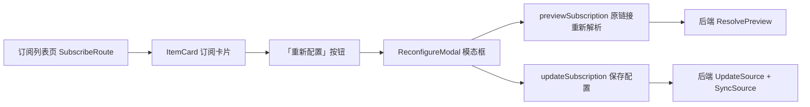

# 已订阅项目重新配置功能

Feature Name: subscription-reconfigure
Updated: 2026-10-19

## Description

为订阅列表的每个订阅提供"重新配置"入口。用户点击「重新配置」后弹出模态框，可调整分区/选集、下载类型、画质和 cron 表达式。订阅链接保持不变（只读展示），订阅源信息不更新，历史检查记录与已记录稿件条目全部保留。

## Architecture



### 交互流程

1. 用户点击订阅卡片上的「重新配置」按钮，创建并打开 `ReconfigureModal`。
2. 模态框打开时，使用订阅类型/资源标识构造原始链接，调用 `previewSubscription` 获取最新分区列表。
3. 分区列表加载完成后，回填当前订阅的已选分区、下载类型、画质和 cron。
4. 用户调整分区、下载类型、画质、cron 后点击「保存」。
5. 前端调用 `updateSubscription`（扩展 payload 支持 `sectionIds`）。
6. 保存成功：刷新订阅列表、关闭模态框；保存失败：提示错误并保持表单内容。

## Components and Interfaces

### 前端

#### `client/src/subscribe/reconfigureModal.ts`（新增）

新增 `ReconfigureModal` 类，基于 Bootstrap modal（参考 `client/src/work/view/parseModal.ts` 的 `ParseModalComp` 实现）。

```ts
class ReconfigureModal implements VanComponent {
    constructor(public item: SubscriptionSource, private onSaved: () => void) {}
    // state: preview, selectedSections, downloadType, format, cronValue, saving
    element: HTMLElement
    show(): void          // 调用 Bootstrap Modal 实例 show，触发 loadPreview
    hide(): void
    async loadPreview(): Promise<void>  // 用 buildSubscriptionURL(item) 调 previewSubscription
    async save(): Promise<void>      // 收集表单值，调 updateSubscription
}
```

职责：
- 展示订阅标题、类型、总条数（只读）与原始链接（只读）。
- 渲染分区 checkbox 列表，默认勾选当前 `item.sectionIds`。
- 提供下载类型、画质、cron 三个表单控件，回填当前值。
- 「保存」按钮调用 `save()`；「取消」按钮使用 `data-bs-dismiss` 关闭。

#### `client/src/subscribe/data.ts`（修改）

- `updateSubscription` payload 扩展 `sectionIds?: string[]`：
  ```ts
  export const updateSubscription = async (payload: {
      id: number
      enabled?: boolean
      downloadType?: SubscriptionSource['downloadType']
      format?: number
      cron?: string
      sectionIds?: string[]
  }) => { ... }
  ```
- 新增 `buildSubscriptionURL(item): string`，由订阅类型/资源标识构造可重新解析的链接：
  | 类型 | 构造链接 |
  |------|---------|
  | season | `https://space.bilibili.com/{mid}/channel/collectiondetail?sid={resourceId}` |
  | series | `https://space.bilibili.com/{mid}/channel/seriesdetail?sid={resourceId}` |
  | fav | `https://www.bilibili.com/list/ml{resourceId}` |
  | space | `https://space.bilibili.com/{resourceId}` |
  | bangumi | `https://www.bilibili.com/bangumi/play/ss{resourceId}` |

#### `client/src/subscribe/index.ts`（修改）

- `ItemCard` 的操作按钮区（`min-width: 96px` 的 vstack）新增「重新配置」按钮，位于「停用/启用」与「删除」之间。
- 点击时创建 `ReconfigureModal(item, () => this.refresh())` 并 `show()`。

### 后端

#### `server/router/subscription.go`（修改）

- `updateSubscriptionBody` 增加字段：
  ```go
  SectionIDs []string `json:"sectionIds"`
  ```
- `updateSubscription` handler：
  - 若 `body.SectionIDs != nil`，将其传入 `UpdateSource`；对 bangumi 类型，空列表回退为 `["main"]`。
  - 更新成功后调用 `GetSource` 并 `SyncSource`，与现有逻辑一致。

#### `server/subscription/store.go`（修改）

- `UpdateSource` 签名扩展：
  ```go
  func UpdateSource(db *sql.DB, id int64, enabled *bool, downloadType string, format int, cron string, sectionIDs []string) error
  ```
- `sectionIDs != nil` 时，更新 `section_ids` 字段；为 `nil` 时保持原值（兼容现有"仅改 cron"的调用）。
- 内部逻辑：先 `GetSource` 读取当前值，合并后执行一条 `UPDATE`。

## Data Models

无数据库结构变更。复用现有 `Source.SectionIDs`（`subscription.section_ids` 列）。

## Correctness Properties

1. 重新配置不修改订阅链接与订阅源信息（type/mid/resource_id/title/cover/owner 不变）。
2. 保存成功后，历史检查记录与 `subscription_item` 稿件条目全部保留。
3. cron 表达式格式错误时，任何字段都不更新。
4. bangumi 类型至少包含一个分区；未选择时默认回退为 `["main"]`。
5. `sectionIds` 为 `nil` 时（未传）不修改 `section_ids` 列，保证旧调用兼容。
6. 保存失败时数据库保持原值，前端保持表单内容不变。

## Error Handling

| 场景 | 处理方式 |
|------|---------|
| `previewSubscription` 重新解析失败 | 使用当前 `item.sectionIds` 作为分区列表回退展示，并 `alert` 解析失败原因 |
| cron 格式错误 | `alert` 提示，不调用保存接口 |
| 保存接口返回错误 | `alert` 错误信息，模态框保持打开，表单内容不变 |
| 分区为空（bangumi） | 前端提示"请至少选择一个分区"，服务端兜底为 `["main"]` |

## Test Strategy

- **后端单元测试**（`server/subscription/store_test.go`）：
  - `UpdateSource` 传入 `sectionIDs` 时正确更新 `section_ids`。
  - `UpdateSource` 传入 `nil` 时保持 `section_ids` 原值。
- **前端手动验证**：
  - 对每种订阅类型打开重新配置弹窗，确认回填正确、分区可调整、保存后列表刷新。
  - 番剧订阅切换分区后，立即检查仅拉取所选分区稿件。
  - 断网/错误场景下确认错误提示与数据不丢失。

## References

- [client/src/subscribe/index.ts](../../../client/src/subscribe/index.ts) - 订阅列表与 ItemCard
- [client/src/subscribe/data.ts](../../../client/src/subscribe/data.ts) - API 数据层
- [client/src/work/view/parseModal.ts](../../../client/src/work/view/parseModal.ts) - Bootstrap 模态框实现参考
- [server/router/subscription.go](../../../server/router/subscription.go) - 订阅路由
- [server/subscription/store.go](../../../server/subscription/store.go) - 数据存储层
- [server/subscription/scheduler.go](../../../server/subscription/scheduler.go) - cron 调度与 SyncSource